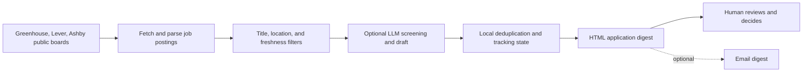

<p align="center">
  
</p>

# OpenHunt

OpenHunt is a privacy-conscious job-search assistant for software engineers.
It collects public job postings from supported applicant-tracking-system APIs,
filters them deterministically, optionally scores them with an LLM, and builds
an application digest.

> OpenHunt never submits applications. A human reviews the results and presses
> the final submit button.

Public ATS listings are fetched and normalized, filtered deterministically, and optionally scored or drafted with a configured language-model provider. The results are deduplicated and rendered as a local digest for a person to review.



OpenHunt does not submit job applications. The mock mode uses offline fixtures; generated profiles, resumes, credentials, tracking state, and digests remain local and are excluded from Git.

Supported sources:

- Greenhouse
- Lever
- Ashby

The parsers are pure functions over decoded JSON, so they can be tested without
network access. The `--mock` mode runs the same parsers against offline
fixtures.

## Quick start

OpenHunt requires Python 3.10 or newer.

```powershell
python -m venv .venv
.\.venv\Scripts\Activate.ps1
pip install -r requirements.txt
python -m openhunt run --mock --scorer keyword
```

The keyword scorer is a development-only token-overlap stub. It requires no
API key and is useful for verifying the complete pipeline.

Open the generated `out/digest.html` locally after the run. The `out/`
directory is intentionally ignored because it may contain resume-derived
content and application-tracking data.

## Configuration

Edit [config.yaml](config.yaml) to tune:

- title include/exclude regular expressions
- accepted locations and remote jobs
- posting freshness
- LLM batch sizes and score thresholds
- local output paths

Edit [companies.yaml](companies.yaml) to choose the boards to poll. ATS slugs
are public board identifiers, not company domains, and should be verified
before relying on them.

## Optional LLM and email features

Copy [.env.example](.env.example) to `.env` and set only the provider and
credentials you need:

```text
LLM_PROVIDER=gemini
GEMINI_API_KEY=replace-me
SCREEN_MODEL=replace-with-a-supported-model
DRAFT_MODEL=replace-with-a-supported-model
```

Available provider integrations are documented in [SETUP.md](SETUP.md).
Credentials, resumes, generated profiles, tracking data, and digests are
ignored by Git and must never be committed.

Build a profile from a local resume:

```powershell
python -m openhunt profile --resume resume.pdf
```

Run the real pipeline:

```powershell
python -m openhunt run
python -m openhunt run --limit 10
python -m openhunt run --no-draft
python -m openhunt run --send
```

## Tracking

OpenHunt stores deduplication and application state in `seen.json`, and can
export a local CSV through the `stats` command:

```powershell
python -m openhunt applied "greenhouse:company:job-id"
python -m openhunt stats
```

`seen.json` is private local state and is intentionally not part of the public
repository.

## Scheduled runs

The workflow in
[.github/workflows/daily.yml](.github/workflows/daily.yml) runs on weekdays at
06:00 IST. It reads credentials and the generated profile from GitHub Actions
secrets, keeps the deduplication file in the Actions cache, and does not upload
personalized digest artifacts.

## Project layout

```text
openhunt/
  fetch.py       ATS clients, Job model, and pure parsers
  prefilter.py   deterministic title/location/freshness gate
  providers.py   provider interface and LLM backends
  llm.py         screening, drafting, and profile generation
  digest.py      local HTML digest generation
  mailer.py      SMTP delivery
  store.py       local deduplication and application tracking
  mock.py        offline ATS-shaped fixtures
  cli.py         profile, run, applied, and stats commands
tests/           parser and LLM behavior tests
```

## Safety and privacy

- Only public ATS APIs are used; no LinkedIn or Naukri scraping.
- No application is submitted automatically.
- API keys, SMTP credentials, resumes, profiles, tracking state, and generated
  output are excluded from version control.
- Review all generated content before using it in an application.

See [SETUP.md](SETUP.md) for the detailed setup guide.

